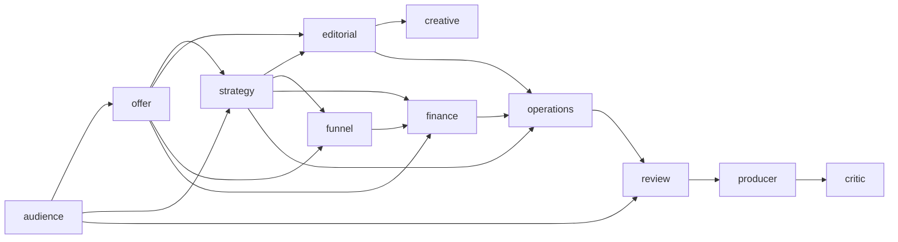

# Launch team

The room can run a local team graph. It is not a live model.

`REAL_MODEL_EXECUTION = NOT_YET_PROVEN`

Two transports share one assignment contract:

- `ModelInvocationExecutor` refuses until an authorized provider exists.
- `ChatBridgeExecutor` refuses until an authorized chat bridge exists.
- `TestDoubleExecutor` is the only executor that returns a result today. Its provenance is `TEST_DOUBLE`.

The registry in `product/team/roles.py` is the specialist list. Review, the producer, and the critic derive their inputs from that list. A new specialist does not require a new queue.



The critic reads the specialist artifacts, not the producer verdict. A job is claimed with one conditional update and a new claim token. Completion, retry, model failure, and a permanent failure change that row only while it is still running for the same token. An expired lease can be claimed again. The previous attempt cannot finish the new one, even when the worker id is reused. Owner constraint changes mark only the affected roles stale and keep the previous rows.

Run the room:

```bash
python3.11 -m launch_os_v11.product --serve
```

Open `http://127.0.0.1:8765/launch-room` and use "Run the launch team". Nothing is published.
